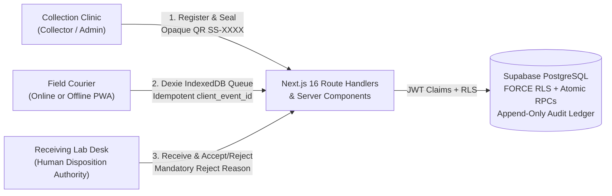

# SampleShield — Specimen Chain-of-Custody & Offline Handover PWA

> **Operational Safety & Synthetic Data Notice:** SampleShield is an operational chain-of-custody visibility application for diagnostic specimen handovers across clinics, couriers, and receiving laboratories. It is **never** a medical device, Laboratory Information System (LIS), clinical decision engine, or autonomous specimen acceptability judge. Only authorized human laboratory personnel may accept or reject specimens. This repository and its seeded demo dataset (`Sahyog Rural Health Network`) use **100% synthetic identifiers (`SS-XXXX-XXXX-XXXX`) with zero real Protected Health Information (PHI)**.

---

## Architecture Overview



### Key Engineering Pillars
- **Zero-PHI Opaque QR Passports:** QR labels encode only a random Crockford Base32 identifier (`SS-XXXX-XXXX-XXXX`). Form schemas (`src/lib/validation/schemas.ts`) actively block accidental entry of email addresses or 10–12 digit phone/national ID strings.
- **Honest Offline-First Courier Queue:** Field handovers save locally to **IndexedDB (`Dexie`)** first with a stable `client_event_id` UUID (`Pending on this device`), survive browser reloads, and transition to `Confirmed by server` only after PostgreSQL returns a verified receipt timestamp.
- **Atomic PostgreSQL State Machine & Multi-Tenant RLS:** Every table enforces `ENABLE` + `FORCE ROW LEVEL SECURITY` with zero `anon` grants and `SELECT`-only direct table privileges for `authenticated`; all writes execute through validated `SECURITY DEFINER` RPCs (`create_sample_atomic`, `submit_custody_event`, `act_on_exception`).
- **Wrong-Destination Blocking & Human-Reviewed Exceptions:** Scanning an Ajmer-routed specimen at Jaipur Hub is atomically blocked (`DESTINATION_MISMATCH`) and logged to the Exception Inbox. Operational SLA alerts (`TRANSIT_DELAY`, `HANDOVER_GAP`) inform human laboratory staff without ever auto-rejecting specimens.
- **Verified vs. Illustrative Analytics:** `/app/analytics` separates server-confirmed operational metrics (median dispatch-to-receipt duration, exception rate, CSV export) from a clearly labelled hypothetical patient-burden scenario calculator.

---

## Repository Structure

- `src/app/` — Next.js 16 App Router pages, PWA manifest (`manifest.ts`), and JSON API route handlers (`src/app/api/*`).
- `src/proxy.ts` & `src/lib/supabase/` — `@supabase/ssr` cookie session proxy and `getClaims()` server verification.
- `src/lib/rules/` — Deterministic custody transition validator, post-event SLA rules, and analytics calculators.
- `src/lib/offline/` — Dexie IndexedDB schema, FIFO backoff sync manager, and React 19 `useSyncExternalStore` connectivity hooks.
- `supabase/migrations/` — Normalized PostgreSQL schema, composite tenant foreign keys, append-only audit triggers, RLS policies, and RPCs.
- `supabase/seed.sql` — Synthetic demo tenant (`Sahyog Rural Health Network`) + isolated non-demo tenant (`Vindhya District Diagnostics`).
- `supabase/tests/01_rls_and_custody_tests.sql` — 14 pgTAP database security & idempotency assertions.
- `tests/unit/` & `tests/e2e/` — Vitest unit suites and Playwright desktop/mobile E2E verification.
- `docs/PRD.md`, `docs/IMPLEMENTATION_PLAN.md`, `docs/DEMO_SCRIPT.md`, `MASTER_BUILD_PROMPT.md`, `AGENTS.md`, `SKILLS_GUIDE.md`, `.agents/skills/` — Product requirements, implementation checklist, 3-minute judge script, and Antigravity skill bundles.

---

## Quick Start (Local Development with Supabase CLI)

### Prerequisites
- Node.js 20+ and npm
- Docker Desktop (running) for the local Supabase PostgreSQL/Auth stack

### 1. Install dependencies & start local Supabase
```bash
npm install
npx supabase start -x realtime,storage-api,imgproxy,mailpit,postgres-meta,studio,edge-runtime,logflare,vector,supavisor
```

### 2. Configure `.env.local` (never committed)
Copy `.env.example` to `.env.local` and paste the `API URL` and `Publishable key` printed by `npx supabase status`:
```env
NEXT_PUBLIC_SUPABASE_URL=http://127.0.0.1:54321
NEXT_PUBLIC_SUPABASE_PUBLISHABLE_KEY=<your-local-publishable-key>
NEXT_PUBLIC_APP_ENV=development
```

### 3. Run the application
```bash
npm run dev
```
Open `http://localhost:3000` (or `/login` for the One-Tap Judge Role Switcher).

---

## Seeded Synthetic Demo Accounts (`Sahyog Rural Health Network`)

All seeded accounts share the demo password: **`SampleShieldDemo!2026`**

| Persona | Email | Role | Assigned Facility | Primary Demo Capability |
| :--- | :--- | :--- | :--- | :--- |
| **Asha Verma** | `asha.collector@sahyog-demo.example` | `collector` | Kishangarh Primary Health Clinic (`PHC-KISH`) | Register specimen, generate opaque QR, collect & dispatch |
| **Ravi Meena** | `ravi.courier@sahyog-demo.example` | `courier` | Network-wide Assigned Transit | Online/Offline courier pickup & drop-off queue (`/app/handovers`) |
| **Dr. Priya Sharma** | `priya.lab@sahyog-demo.example` | `lab` | Ajmer District Reference Lab (`LAB-AJMR`) | Authorized lab receipt, human acceptance/rejection, exception review |
| **Kabir Joshi** | `kabir.jaipur@sahyog-demo.example` | `lab` | Jaipur Regional Diagnostic Hub (`LAB-JAIP`) | Demonstrates server-blocked `DESTINATION_MISMATCH` guard |
| **Meera Nair** | `meera.admin@sahyog-demo.example` | `admin` | All Facilities (`Sahyog Network`) | Facility policies, verified analytics, and Judge Failure Simulator (`/app/demo`) |

---

## Quality & Security Verification Commands

```bash
# 1. Strict TypeScript & ESLint checks
npm run typecheck
npm run lint

# 2. Vitest unit tests (state machine, anti-PHI Zod schemas, analytics, IndexedDB sync)
npm run test

# 3. PostgreSQL pgTAP RLS, tenant isolation, append-only ledger & idempotency tests
npx supabase test db

# 4. Production Next.js build
npm run build

# 5. Playwright E2E tests (Desktop 1440x900 + Mobile 375x812, including offline reload round-trip)
npm run test:e2e
```

---

## Hosted Supabase & Vercel Deployment Guide

1. **Link Hosted Supabase Project & Push Schema:**
   ```bash
   npx supabase link --project-ref <your-supabase-project-ref>
   npx supabase db push
   ```
   *(Optional for demo environments only: seed synthetic fixtures via SQL Editor using `supabase/seed.sql`.)*
2. **Configure Supabase Auth URLs:**
   - In **Supabase Dashboard → Authentication → URL Configuration**, set **Site URL** to your production Vercel domain (e.g., `https://sampleshield.vercel.app`) and add `https://*.vercel.app/auth/callback` + `http://localhost:3000/auth/callback` to **Redirect URLs**.
3. **Configure Vercel Environment Variables (Preview & Production):**
   - `NEXT_PUBLIC_SUPABASE_URL` — Hosted project URL (`https://<ref>.supabase.co`)
   - `NEXT_PUBLIC_SUPABASE_PUBLISHABLE_KEY` — Supabase publishable (`sb_publishable_...` or `anon`) key
   - `NEXT_PUBLIC_APP_ENV` — `preview` or `production`
   - **Never** add `SUPABASE_SERVICE_ROLE_KEY` to `NEXT_PUBLIC_*` variables or client bundles.

---

## Do Not Confuse Demo Setup with Clinical Production Readiness

SampleShield is an operational chain-of-custody engineering MVP built for hackathon evaluation. Real-world healthcare deployment requires independent institutional privacy, security, regulatory, and laboratory standard-operating-procedure (SOP) review before handling real patient specimens.
